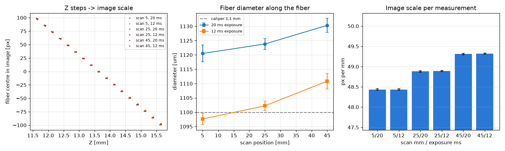
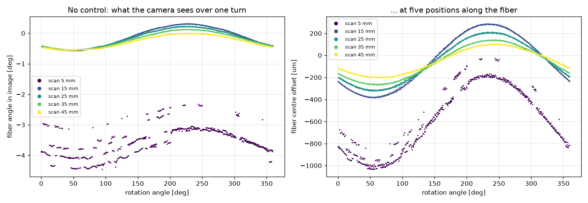
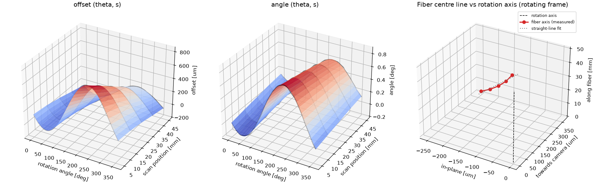
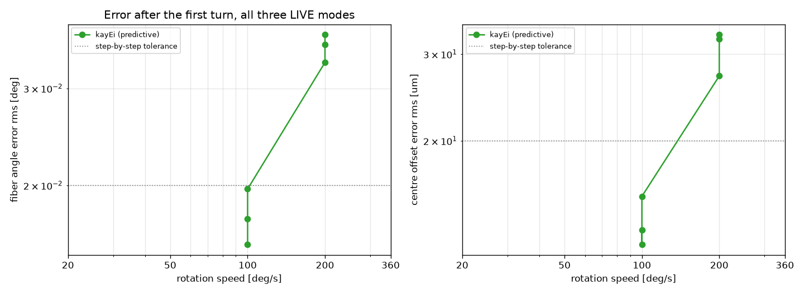
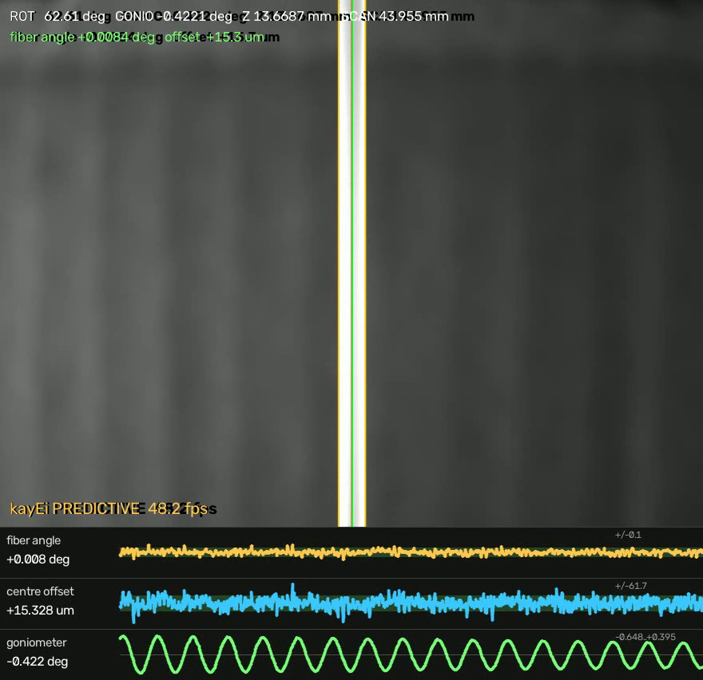

# Camera-guided alignment of a rotating fiber: from step-by-step feedback to predictive control (kayEi)

Working document, started 2026-10-31. Everything here is measured on the station in
`C:\dev\hydra`; scripts and raw data are named at each step so every number can be
regenerated. Numbers are given as measured, including the ones that did not work.

## 1. Problem

A fiber (diameter about 1.1 mm as seen by the camera) is held in a 3-jaw chuck on a
rotation stage. The side surface of the fiber has to stay in the focal plane of a
processing laser while the fiber rotates about its axis and is translated along it.
Two things move the surface out of the plane:

- the fiber axis is **tilted** with respect to the rotation axis (chuck, fiber bend),
  so its direction in the image changes with the rotation angle;
- the fiber axis is **offset** from the rotation axis (eccentricity), so its position
  in the image changes with the rotation angle, and because of the tilt this offset
  also changes along the fiber.

In the setup the laser focus is simulated by the camera's own position. Alignment means:
the fiber appears straight along a reference direction (goniometer) and centred
(camera height stage), at every rotation angle and every position along the fiber.

## 2. Setup

```
goniometer (Hydra axis 1, 2-phase stepper, +/-5.17 deg, 4 deg/s, accel 50 deg/s^2)
  -> rotation stage (Hydra axis 2, brushless servo, encoder, 360 deg/s, 10000 deg/s^2)
     -> 3-jaw chuck -> fiber
scan stage (PI C-663 SN 0165500183, VT-80 50 mm, along the fiber)
  -> Z stage (PI C-663 SN 0165500187, VT-80 25 mm, camera height)
     -> Baumer VCXG-15M GigE camera, 1440 x 1080, mono 8 bit, 20 ms exposure
```

| Quantity | Value | How it was obtained |
|---|---|---|
| Image scale | 49.5 px per mm of Z travel, i.e. **~20 um/px** | Z calibration, `fiber_align.py --calib` |
| Camera orientation | rotated 90 deg: the fiber appears vertical, Z moves it sideways | Z scan, `find_fiber.py` |
| Goniometer -> image angle | -1.01 to -1.02 deg/deg | calibration (4 repeats over 2 days) |
| Goniometer -> image offset | -62 to -74 px/deg at scan position 1 mm (lever arm from the pivot; changes along the scan) | calibration |
| Frame period | 20.2 ms (exposure bound) | `kayei_learn.py latency` |
| Hydra query / command | ~7 ms | timing test |
| PI C-663 (USB) query / MOV | ~32 ms / ~16 ms | timing test 2026-10-30 |

The PI controllers are slow to ask; all loops therefore work with *commanded* PI positions
and only poll when they must.

## 3. Measuring the fiber in the image

`fiber_align.measure()` fits both fiber edges. The image is cut into 36 horizontal bands;
in each band the column profile is thresholded and the **outermost** crossings on both
sides are taken, each at half of its *own* rim height, with sub-pixel interpolation.
The centre line of all bands is fitted with a straight line, giving

- the fiber **angle** in the image (deg from vertical),
- the **offset** of the centre line from the image centre (px) at mid-height,
- the width and the rms of the straight-line fit (a quality check; frames with a poor
  fit are not used for control).

Why outermost edges: the fiber is a transparent cylinder. At short exposure it shows two
bright rims, a dim core and glints. A simple threshold at the brightest point locks on a
glint and gives wrong angles. With the outermost-edge rule the measurement is consistent
from 10 ms to 50 ms exposure (angle within 0.05 deg, offset within 0.3 px); below 10 ms
the rims are too dim, at 100 ms the background saturates. Default: 20 ms, camera gain
raised automatically when the illumination is dim (`kayei_learn.Rig`).

Noise floor with everything static: **0.0002 deg** angle, 0.02 px offset (std over 15
frames). This is far below any mechanical effect.

Robustness (added 2026-10-31 evening): the straight-line fit over the bands sigma-clips
bands whose width or centre disagree with the rest, so an object crossing the fiber in part
of the image (section 5b, a hanging wire) or a glint merging with an edge does not pull the
line. At least 8 clean bands are required, otherwise the frame is reported as "no fiber".

### 3.1 Image scale and fiber diameter (2026-10-31)

`fiber_diameter.py`: Z stepped over +/-2 mm in 0.25 mm steps (5 frames per step), the
fiber-centre shift fitted against Z; the fiber width (outermost edges) converted with it.

| Scan position | Image scale | Width 20 / 12 ms | Diameter 20 / 12 ms |
|---|---|---|---|
| 5 mm | 48.43 +/- 0.02 px/mm | 54.3 / 53.2 px | 1.121 / 1.098 mm |
| 25 mm | 48.88 +/- 0.02 px/mm | 54.9 / 53.9 px | 1.124 / 1.102 mm |
| 45 mm | 49.31 +/- 0.02 px/mm | 55.7 / 54.8 px | 1.130 / 1.111 mm |

- **Diameter 1.114 +/- 0.012 mm** (caliper 1.1 mm). The +/-0.01 mm is the exposure
  dependence of the apparent width (about 1 px): the half-rim-height edge of a transparent
  cylinder moves slightly with the rim brightness. Within one exposure the width is
  repeatable to 0.1 px.
- **Image scale 20.46 um/px** on average, but it grows by 1.8 % from scan position 5 to
  45 mm (48.4 -> 49.3 px/mm): the fiber comes closer to the camera along its length. That is
  the out-of-plane component of the fiber tilt - the focus variation the model predicts
  (section 7.4, open physics) and no axis in this setup corrects. kayEi uses the scale
  at the calibration position; a 1.8 % scale error on a 22 px correction is 0.4 px,
  comparable to the measurement noise.



## 4. Step-by-step alignment (2026-10-30)

`fiber_align.py`: calibrate (finite differences of goniometer and Z), then iterate
"goniometer removes the angle, Z removes the offset" until |angle| < 0.02 deg and
|offset| < 1 px. At six rotation angles (0..300 deg) every alignment converged in 1-2
iterations, about 1.5 s each:

| Rotation | Goniometer | Z (mm) | Remaining angle | Remaining offset |
|---|---|---|---|---|
| 0 | -0.309 | 13.557 | +0.006 deg | -0.35 px |
| 60 | -0.006 | 13.331 | +0.017 | -0.17 |
| 120 | +0.248 | 13.165 | +0.018 | -0.13 |
| 180 | +0.191 | 13.223 | +0.000 | +0.04 |
| 240 | -0.103 | 13.433 | -0.015 | +0.07 |
| 300 | -0.354 | 13.587 | -0.016 | +0.35 |

The goniometer setting over the turn already shows the sine that is the subject of
everything below. Data: `fiber_align.csv`, images `fiber_align_<angle>.png`.


## 5. Feedback tracking while rotating ("live align", 2026-10-30)

Rotation and scan run continuously; every fresh frame the goniometer gets a
proportional correction of the measured angle and Z of the measured offset (gain 0.6,
dead band 0.005 deg / 0.3 px, 36-44 corrections/s). `gui.py`, LIVE mode "Live align".

| Rotation speed | Angle error rms / max | Offset error rms / max |
|---|---|---|
| no compensation ("as is"), 20 deg/s | 0.27-0.41 deg / 0.55-0.68 | 150-182 um / 350-362 um |
| live align, 20 deg/s | 0.021 deg / 0.058 | 9.7 um / 57 um |
| live align, 50 deg/s | 0.039 / 0.081 | 9.1 / 34 |
| live align, 100 deg/s | **0.111** / 0.248 | 27.6 / 105 |


Top: without compensation the angle and offset follow slow sines while the goniometer
stays flat. Bottom: with feedback the errors stay inside the tolerance band and the
goniometer does the sine instead. Feedback is good at low speed and degrades with speed:
it only *reacts*, so with a loop delay tau the error grows like (wobble rate x tau).

## 5b. The uncontrolled motion in 2D, 3D and 4D (2026-10-31)

`fiber_wobble_map.py`: goniometer and Z fixed (aligned once at scan position 25 mm), two
turns at 60 deg/s at scan positions 5, 15, 25, 35, 45 mm, every frame measured
(`kayei_data/wobble_map.csv`, ~600 frames per position).

| Scan position | Angle sine | Offset sine | Sine residual |
|---|---|---|---|
| 5 mm | 0.488 deg | 420 um | 0.006 deg / 2 um |
| 15 mm | 0.438 deg | 342 um | 0.006 deg / 2 um |
| 25 mm | 0.387 deg | 272 um | 0.006 deg / 2 um |
| 35 mm | 0.337 deg | 211 um | 0.003 deg / 2 um |
| 45 mm | 0.284 deg | 158 um | 0.005 deg / 2 um |



**3D from one camera.** The camera sees one lateral component of the fiber, but over a
turn the sine's cosine and sine coefficients at a scan position are the two components of
the fiber axis offset in the rotating frame, (e_x, e_y)(s) = (B1, -B2)(s): the in-plane
part and the out-of-plane part (towards the camera, i.e. the focus direction) that no
single frame shows. Five scan positions give the fiber's centre line in 3D relative to the
rotation axis (`kayei_data/wobble_map_axis.csv`):

- eccentricity at the chuck (s = 0): (-255, +366) um; tilt (+0.254, -0.287) deg,
  **0.383 deg total**; the fiber axis crosses the rotation axis at about s = 70 mm
  (the offset amplitude falls from 420 to 158 um along the scan).
- the five points lie on a straight line within **5 / 4 um** rms. The gentle bend shows
  more clearly in the angle data: the local angle amplitude falls 0.49 -> 0.28 deg along
  the fiber, i.e. a curvature of 9e-5 rad/mm, radius about 11 m, sagitta ~18 um over
  40 mm - consistent with the 5 um straight-line residual after the linear fit.
- the offset phase turns by 12 deg along the scan: eccentricity and tilt vectors are not
  parallel, so the swept surface is a one-sheet hyperboloid, not a cone.



**Repeatability.** The whole measurement was repeated 75 minutes later (18:30). The 3D axis
agrees **in-plane to 1-3 um** at all five positions; the out-of-plane component shifted by
-9 to -15 um throughout. That component comes from the quadrature phase of the sine, so it
is sensitive to timing: 12 um on a 400 um amplitude is a 1.7 deg phase shift, i.e. about
28 ms at 60 deg/s. The in-plane component is what the alignment acts on and is robust; the
out-of-plane (focus) estimate needs a dedicated phase check before it is trusted below
~15 um. Data: `kayei_data/wobble_map_{1715,1830}.csv`, `wobble_map_axis_{1715,1830}.csv`.

Between the two runs a small weight (a bent wire) had been hung on the free end of the
fiber. It does not rotate with the fiber, so it bends the fiber statically and leaves the
sine amplitudes unchanged (5 mm: 420 -> 409 um, 45 mm: 158 -> 150 um) - a hanging load is
not a way to enlarge the wobble. But at scan position 5 mm it crosses the fiber in the
lower part of the image (`kayei_data/scan5_sheet.png`), and the 18:30 angle data there are
corrupted (490 of 598 frames off by up to 1 deg, offset residual 55 um): the straight-line
fit then included the bands where the wire merges with the fiber. Fix (same evening):
`fiber_align.measure()` now sigma-clips the bands - width outliers first, then centre-line
outliers over 4 iterations - and with that the fiber at 5 mm is measured correctly in the
presence of the wire (26-27 of 36 bands kept, fit residual 0.13-0.25 px). The 18:30 offset
numbers at 5 mm in the table above are from before the fix and carry that error; the
other positions are unaffected (the wire is out of view there).

**4D.** `docs/figures/wobble_4d.mp4` shows the reconstructed axis rotating in 3D (left,
with the circles swept by each point over a turn) and, on the right, the in-plane offset
the camera sees against the out-of-plane offset it cannot see, both along the fiber.

## 5c. A large, learnable disturbance: the fiber re-clamped off-centre and tilted (2026-10-31 evening)

For the laser application the lateral position of the fiber matters more than its angle
(the fiber has to stay in the focus), and a 0.1 deg wobble does not stress the method. So
the wire of 7.3c was removed, the fiber was re-clamped deliberately off-centre and tilted,
and the illumination was changed to a lamp that makes the fiber glow (bright on grey instead
of dark on bright). The glow saturates the sensor at the old 20 ms exposure - the band fit
then locks on the saturated halo and reports a 406 px "fiber" - so the exposure is now
**4 ms** (`fiber_align.EXPOSURE_MS`): width 54.6 px as before, noise 0.0002 deg / 0.004 px
per frame, 1 % saturated pixels, and the camera runs at 13.2 ms per frame instead of 20.2
(the runs below log 66 frames/s). The frame-to-encoder delay re-measured at 4 ms exposure is
31 ms, the same as at 20 ms (6.3), so nothing in the timing model changed.

The 5-position characterisation of 5b, repeated on the new clamping
(`fiber_wobble_map.py`, `kayei_data/wobble_map_2035_tilted.csv`,
`docs/figures/wobble_{2d,3d}_tilted.png`, `wobble_4d_tilted.mp4`):

| scan [mm] | angle amplitude [deg] | offset amplitude [um] | sine residual angle / offset |
|---|---|---|---|
| 5 | 1.357 | 1645 | 0.024 deg / 27 um |
| 15 | 1.304 | 1418 | 0.021 / 20 |
| 25 | 1.257 | 1198 | 0.018 / 15 |
| 35 | 1.206 | 986 | 0.013 / 10 |
| 45 | 1.151 | 780 | 0.010 / 7 |

Fiber axis vs rotation axis: eccentricity at the chuck (+1282, +1186) um, tilt
(-0.900, -0.852) deg = **1.239 deg**, straight to 4 um over 40 mm. That is 12x the angle and
16x the offset of the morning (5b). The sine residual (last column) is now visibly
non-sinusoidal and repeatable turn to turn (0.0239 vs 0.0236 deg in `kayei_learn.py wobble`):
the shape of the chuck's grip, growing towards the free end - exactly what the residual
learner in 7.1 exists for.

What this amplitude demands from the axes: a 1.26 deg sine at the rotation frequency needs a
goniometer peak rate of 2.2 deg/s at 100 deg/s, 4.4 at 200 and 7.9 at 360 deg/s - the stage
is configured for 4 deg/s. Z needs 2.1 / 4.2 / 7.5 mm/s of its 10. So from 200 deg/s on the
goniometer is at its limit by construction; this is the regime the evening was about.

## 6. System identification for prediction (2026-10-31)

### 6.1 Latency: command -> image

`kayei_learn.py latency`: 0.3 deg goniometer steps while grabbing fresh frames.

- The image responds **58 ms** after the command (4 repeats, all 58 ms).
- The step is settled after **159 ms** (goniometer travel at 4 deg/s with 50 deg/s^2).
- Angle noise during the test 0.0002 deg.


### 6.2 The wobble is a sine - and how good a sine

Geometry: a straight fiber is a line offset by (e_x, e_y) from the rotation axis at the
chuck and tilted by (t_x, t_y). Rotating by th and projecting onto the camera's view
plane gives

```
angle(th)      = a0 + A1 cos th + A2 sin th                   (independent of scan position s)
offset(th, s)  = b0 + b1 s + (B1 + C1 s) cos th + (B2 + C2 s) sin th
```

`kayei_learn.py wobble`: two full turns at 30 and at 90 deg/s with the goniometer fixed,
fresh frames stamped with the encoder angle.

| Speed | Angle: amplitude, fit residual, turn 1 -> turn 2 | Offset: amplitude, residual, turn 1 -> 2 |
|---|---|---|
| 30 deg/s | 0.440 deg, **0.0073 deg**, 0.0081 deg | 17.15 px (0.35 mm), **0.106 px**, 0.104 px |
| 90 deg/s | 0.441 deg, 0.0064 deg, 0.0064 deg | 17.13 px, 0.098 px, 0.096 px |

The residual after the sine is 1.7 % of the amplitude for the angle and 0.6 % for the
offset, and a model fitted on turn 1 predicts turn 2 equally well. The residual has a
repeatable shape over the turn (the two turns and the two speeds overlap in the figure):
higher harmonics of about +/-0.015 deg and +/-0.25 px, presumably bearing / chuck
signature. Repeatable means learnable (section 7.3).


### 6.3 Frame-to-encoder delay

The phase of the fitted sine shifts by +1.6 deg (angle) / +1.9 deg (offset) between 30
and 90 deg/s, i.e. the frame is exposed about **30 ms** before the encoder is read after
it arrives. With this correction applied, the measured phase is the same at 90, 200 and
360 deg/s within 0.4 deg. (`FRAME_DELAY = 0.030 s` in `kayei.py`.)

### 6.4 Goniometer dynamics

Three tests separate controller, mechanics and loop:

| Test | Result |
|---|---|
| Hydra executing a 50 Hz stream of `nm` commands along a 0.44 deg sine, read back with `np` (rotation stopped) | full amplitude at all periods; lag 25 / 30 / 35 ms for peak rates 0.38 / 0.77 / 1.54 deg/s; 0.002-0.007 deg deviation |
| same, read back by the **camera** (fiber angle) | full amplitude; lag 66 / 66 / 74 / 84 ms (arrival-time basis) for 0.38 / 0.77 / 1.54 / 3.07 deg/s; 0.004-0.025 deg |
| Hydra readback of the stream while the rotation spins at 200 deg/s | still full amplitude, lag 46 ms (vs 34 ms without spin) |

The goniometer therefore follows a 50 Hz target stream well up to rates beyond what a
360 deg/s rotation requires (0.44 deg x 2 pi x 1 turn/s = 2.8 deg/s), with a delay that
grows slowly with the rate.

### 6.5 Z stage dynamics

Same tests as 6.4 for the camera height stage (PI C-663, VT-80 25 mm), camera-timed
(`kayei_data/z_dyn.py`): a 0.2 mm step shows in the image after **58 ms** (4 repeats) and
is settled after 98 ms; a 0.45 mm sine stream at 50 Hz is followed with full amplitude and
60 / 64 / 68 ms lag for peak rates 0.79 / 1.57 / 2.83 mm/s (8-16 um rms), identical at
stage velocity 10 and 20 mm/s. Z therefore gets the same lead law as the goniometer.
The first full-system run used a guessed 60 ms Z lead and showed 22 um rms offset error;
the measured ~35 ms lead brought it to 10 um (7.2b) - a 25 ms lead error at 100 deg/s is
2.5 deg of phase on a 22 px sine, i.e. about 1 px.

### 6.6 Controller quirks found on the way (Hydra TT, Venus-3)

- `setnpos v` sets the *origin*: the current position becomes **-v**. It also drags the
  soft limits to [pos - 72000, pos].
- A move whose target lies outside the soft limits is refused with error **1004**
  (not executed at all). This is what stopped a sweep after ~17000 deg of one-way
  rotation, and is the likely meaning of the 1004 errors seen the day before.
- Fix: `Hydra.rezero_turn()` keeps the rotation count within one turn (same angle modulo
  360, so learned models stay valid) and sets the limits to +/-36000 deg explicitly.

### 6.7 What a stepper does with a 50 Hz target stream (found with the large wobble)

The first kayEi runs on the tilted fiber (unchanged software) gave 0.033 deg / 47 um at
100 deg/s and 0.056 deg / 115 um at 200 deg/s - 4-5x the morning's numbers, and 2.6-4.4 % of
the amplitude, where the morning's 0.007 deg had been 7 % of its 0.1 deg amplitude. Relative
to the amplitude nothing had improved or degraded; the 6.4/6.5 tests had simply been made at
amplitudes too small to show what the stages do. Streaming a 1.26 deg sine to the goniometer
and reading the encoder (`kayei_data/gonio_shape.py`, `docs/figures/gonio_stop_and_go.png`)
shows it: the stage moves in **bursts at 4-5 deg/s towards a stale target, stops, waits
100-300 ms, moves again** - 28-31 % of the time standing still, lagging the command by
100-300 ms. The controller re-plans a full trapezoid for every new target at its configured
maximum speed, so a dense stream of small targets becomes stop-and-go. Three more facts came
out of the same tests (`track_test.py`, `track_matrix.py`, all in `kayei_data/`):

- the Hydra's command parser handles about 165 commands/s in total; polling the encoder
  while streaming (my first test) halves the stream's effective rate and corrupts both;
- raising the goniometer acceleration from 50 to 400 deg/s2 makes it lose steps (0.070 deg
  after one test, open-loop stepper); 150 deg/s2 brings nothing measurable;
- a C-663 command costs 16 ms over USB because pipython asks for the error after every
  command; with the error check off it costs 1.1 ms (checked once per run instead).

**Velocity-shaped streaming.** The fix is to tell the stage, every tick, the speed the
trajectory needs over the next tick (x 1.15 margin, floor 0.02 deg/s and 0.05 mm/s) and the
target one lead ahead (`setnvel` + `move` on the Hydra, `VEL` + `MOV` on the C-663), so the
trapezoid it plans is the trajectory itself. Camera-sensed sine tracking, no controller
polling (`kayei_data/vshape_test.py`, `docs/figures/stream_shaping.png`; "lag" includes the
30 ms frame delay, so 30 ms means on time):

| axis, sine | plain stream: lag, non-sine error | shaped, lead 60 / 40 ms | shaped, lead 120 / 80 ms |
|---|---|---|---|
| goniometer 1.26 deg at 0.278 Hz (= 100 deg/s) | 67 ms, 0.044 deg | 17 ms, 0.034 deg | -43 ms, 0.036 deg |
| goniometer 1.26 deg at 0.556 Hz (= 200 deg/s) | 89 ms, 0.041 deg | 42 ms, 0.034 deg | -18 ms, 0.033 deg |
| Z 1.2 mm at 0.278 Hz | 55 ms, 11.7 um | 39 ms, 6.5 um | -1 ms, 6.6 um |
| Z 1.2 mm at 0.556 Hz | 63 ms, 16.2 um | 48 ms, 17.6 um | +8 ms, 17.6 um |

Shaping turns the lag into a clean, lead-correctable delay (optimum lead: goniometer
~47 ms at 100 deg/s and ~72 ms at 200, `kayei.gonio_lead`; Z ~49 / ~58 ms, `kayei.z_lead`)
and removes a quarter of the goniometer's and half of Z's non-sine error. What remains -
0.034 deg on the goniometer, 7-18 um on Z - is the stages' own motion ripple at these rates;
no command strategy tried (100 Hz stream, higher acceleration) reduces it further. The
goniometer's ripple also appears in the offset through its lever arm (-62 px/deg, 3.1): 0.03
deg of goniometer is 40 um of fiber offset at the camera position.

## 7. kayEi: predictive alignment

### 7.1 Idea

The disturbance is a known function of the rotation angle, and the rotation angle is
known in advance (encoder repeatable to 0.00003 deg, commanded speed accurate to 0.01 %).
So the goniometer and Z are driven to where the fiber *will* be; the camera no longer
has to chase. Components (`kayei.py`):

- **RotClock**: rotation angle as a function of time from the commanded speed, re-synced
  to the encoder every 0.25 s (clock vs encoder < 1 deg at 360 deg/s).
- **WobbleModel**: the sine of section 6.2, linear in the scan position (6 coefficients
  for the offset, 3 for the angle), fitted from two learning turns.
- **Predictor**: goniometer = g_al - angle(th)/a_per_g; Z = z_al - (offset(th, s) +
  x_per_g(s) * dg)/x_per_z, where x_per_g(s) is the goniometer's image shift at scan
  position s (lever arm, linear in s). g_al, z_al: the aligned reference.
- **Tracker** thread: streams the targets at a fixed 50 or 100 Hz from the clock, with
  separate lead times for goniometer and Z, over its own Hydra socket. The camera loop
  is decoupled: it measures, learns and re-syncs the clock.
- **Residual** table (iterative learning): 72 bins over the turn; whatever the camera
  still sees at an angle is written into the bin (gain 0.3) and applied on the next
  visits. The table is kept zero-mean; the mean goes to a slow integral **trim**.

### 7.2 Results so far: goniometer axis, feed-forward only

No residual table, no trim, learned from two turns at 90 deg/s (`kayei_data/gonio_tracker.csv`,
`kayei_data/tracker_test.py`):

| Rotation | Lead 0 | 15 ms | 30 ms | 45 ms | 30 ms @ 100 Hz |
|---|---|---|---|---|---|
| 100 deg/s | - | 0.019 | **0.015** | - | - |
| 200 deg/s | 0.044 | 0.030 | 0.015 | **0.013** | 0.0125 |
| 360 deg/s | - | 0.066 | 0.038 | **0.017** | 0.025 |

(angle error rms over turns 2-3, deg; every run has a constant bias of -0.011 deg that
the trim will remove, so the shape error alone is about 0.010 deg at 100-200 deg/s.)


Compared with feedback at 100 deg/s (0.111 deg) this is 7-8x better, and 360 deg/s -
not reachable with feedback at all - is within the step-by-step tolerance. The best lead
grows with speed (30 -> 45 ms), consistent with the rate-dependent goniometer lag of
6.4; the lead will be a function of the required rate rather than a constant.

An earlier version of this test (camera loop and goniometer commands in one thread,
`kayei_data/gonio_ff_test.csv`) gave 0.099 deg at 200 deg/s with a clean, repeatable
error sine that could not be reproduced afterwards (same configuration: 0.033 deg). It
is recorded here because it is unexplained, not because it is understood.

### 7.2b Full system at 100 deg/s (goniometer + Z + scan), 2026-10-31 afternoon

Through the GUI worker (`gui.py` LIVE mode "kayEi", residual learning on), rotation
100 deg/s, scan 5-45 mm at 1 mm/s where noted. Errors after the first turn
(`kayei_eval.py`):

| Change | Scan | Angle rms / max | Offset rms / max |
|---|---|---|---|
| first full run (Z lead guessed 60 ms, angle model without s) | no | 0.0098 deg / 0.039 | 21.7 um / 88 |
| same | yes | 0.0377 / 0.177 | 57.1 / 312 |
| Z lead measured (35 ms), angle model linear in s | no | 0.0083 / 0.040 | 9.9 / 47 |
| same | yes | 0.0139 / 0.105 | 22.4 / 190 |
| + pre-positioning before the rotation starts, residual learning only after turn 1, query-free scan turnaround | yes | **0.0078 / 0.032** | **7.4 / 42** |

Two things were learned on the way, both visible only in the per-frame logs:

- **The fiber is not straight over 45 mm.** With learning turns at both ends of the scan,
  the angle sine differs between the ends (amplitude change 0.005 deg/mm); a model with
  the angle independent of s had a 0.08 deg residual, with the angle linear in s it is
  back to 0.006 deg. The goniometer lever arm also changes along the scan, as expected:
  x_per_g = -84 + 0.82 s px/deg (0.86 predicted from tan(1 deg) x 49.5 px/mm).
- **Start transients get learned.** The residual table wrote the start jump of the first
  turn into the bins of the start angle (0.03-0.04 deg, 50-70 um at th = 120-160 deg,
  decaying by 30 % per turn). Letting the axes settle before the rotation starts and
  enabling the table only after one full turn removed it.

### 7.3 Full comparison: as is / live align / kayEi, 20-360 deg/s, without and with scan

`kayei_sweep.py` (2026-10-31 17:10-17:25, 30 runs, 25-45 s each, same fiber, same light;
kayEi model learned once at both scan ends, residual table and trim reset per run;
scan 5-45 mm at 1 mm/s). Errors from the per-frame logs after the first full turn and the
first 2 s (`kayei_eval.py "20261031_17[12]"`):



| Mode | Rotation | Scan | Turns evaluated | Angle rms / max [deg] | Offset rms / max [um] |
|---|---|---|---|---|---|
| as is | 20 deg/s | no | 2 | 0.2859 / 0.420 | 209.2 / 340 |
| live align | 20 deg/s | no | 3 | 0.0197 / 0.042 | 6.9 / 23 |
| kayEi | 20 deg/s | no | 2 | 0.0067 / 0.022 | 8.0 / 30 |
| as is | 20 deg/s | yes | 3 | 0.4513 / 0.710 | 263.3 / 457 |
| live align | 20 deg/s | yes | 2 | 0.0232 / 0.052 | 9.4 / 31 |
| kayEi | 20 deg/s | yes | 3 | 0.0095 / 0.044 | 12.7 / 61 |
| as is | 50 deg/s | no | 4 | 0.3269 / 0.567 | 191.5 / 334 |
| live align | 50 deg/s | no | 4 | 0.0440 / 0.085 | 10.0 / 35 |
| kayEi | 50 deg/s | no | 4 | 0.0069 / 0.025 | 9.1 / 29 |
| as is | 50 deg/s | yes | 4 | 0.3248 / 0.554 | 158.7 / 283 |
| live align | 50 deg/s | yes | 4 | 0.0500 / 0.103 | 12.7 / 53 |
| kayEi | 50 deg/s | yes | 4 | 0.0092 / 0.068 | 10.7 / 61 |
| as is | 100 deg/s | no | 6 | 0.2058 / 0.286 | 123.4 / 208 |
| live align | 100 deg/s | no | 6 | 0.0811 / 0.159 | 14.8 / 50 |
| kayEi | 100 deg/s | no | 7 | 0.0091 / 0.041 | 12.2 / 70 |
| as is | 100 deg/s | yes | 7 | 0.2906 / 0.491 | 171.4 / 291 |
| live align | 100 deg/s | yes | 6 | 0.0990 / 0.187 | 21.3 / 73 |
| kayEi | 100 deg/s | yes | 7 | 0.0107 / 0.051 | 12.4 / 72 |
| as is | 200 deg/s | no | 13 | 0.2283 / 0.384 | 116.0 / 174 |
| live align | 200 deg/s | no | 13 | 0.1543 / 0.268 | 27.7 / 77 |
| kayEi | 200 deg/s | no | 14 | 0.0089 / 0.041 | 11.6 / 42 |
| as is | 200 deg/s | yes | 13 | 0.3039 / 0.499 | 181.2 / 298 |
| live align | 200 deg/s | yes | 13 | 0.1920 / 0.346 | 41.2 / 141 |
| kayEi | 200 deg/s | yes | 13 | 0.0100 / 0.035 | 12.5 / 45 |
| as is | 360 deg/s | no | 25 | 0.2999 / 0.502 | 153.8 / 264 |
| live align | 360 deg/s | no | 23 | 0.2363 / 0.378 | 66.3 / 228 |
| kayEi | 360 deg/s | no | 24 | 0.0139 / 0.073 | 20.9 / 79 |
| as is | 360 deg/s | yes | 24 | 0.2197 / 0.369 | 111.8 / 160 |
| live align | 360 deg/s | yes | 17 | 0.2742 / 0.477 | 474.3 / 2982 |
| kayEi | 360 deg/s | yes | 24 | 0.0158 / 0.059 | 22.1 / 79 |

Reading the table:

- **Feedback (live align) is a function of speed; kayEi is not.** Feedback goes from
  0.020 deg / 7 um at 20 deg/s to 0.24 deg / 66 um at 360 deg/s - at 100 deg/s and
  above it no longer meets the step-by-step tolerance (0.02 deg / 20 um), and at
  360 deg/s with scanning it diverged (Z driven to its 25 mm limit, run aborted by the
  range check). kayEi stays at **0.007-0.016 deg** and **8-22 um** over the whole range;
  the angle is within tolerance everywhere, the offset up to 200 deg/s and marginal
  (21-22 um) at 360 deg/s.
- **Scanning costs kayEi almost nothing** (angle +0.001 to +0.003 deg, offset +0 to
  +5 um), because the model is linear in the scan position and the goniometer lever arm
  is part of it. For feedback the scan adds 20-50 %.
- **Where kayEi's remaining error comes from.** At 20-50 deg/s the angle error (0.007 deg)
  equals the sine model's own residual (6.2); the offset error (8-9 um = 0.4 px) is
  about 4x the measurement noise and 2x the model residual. The slow rise towards
  360 deg/s (0.014 deg, 21 um) matches the lead law being tuned at 100-200 deg/s only
  (7.2: best lead grows with the required axis rate) and the 50 Hz command stream
  (7.2 deg of rotation per command at 360 deg/s).
- The as-is rows are the disturbance itself: 0.2-0.45 deg and 110-260 um rms,
  independent of speed as it should be. The angle amplitude differs between the morning
  (0.44 deg, measured at scan position 1 mm) and the afternoon (0.51 deg, learned at 20-26 mm):
  nobody touched the fiber; it is the bend of the fiber (0.005 deg/mm amplitude change along
  it, section 7.2b) over the 20 mm between the two scan positions. The as-is scatter is one
  reason every mode is compared within the same sweep only.

### 7.3b Demo run with movies (2026-10-31, 17:55-17:58)

`kayei_record.py 200 40`: the three modes back to back at 200 deg/s with the 5-45 mm scan,
recorded headlessly with the GUI's own view (image, fiber overlay, heads-up display, live
charts). Movies in `kayei_data/demo_20261031_175525_{asis,align,kayei,all}.mp4` (not in
git, 150 MB); the kayEi movie includes its 40 s learning phase.

| Mode | Angle rms / max | Offset rms / max |
|---|---|---|
| as is | 0.43 deg / 0.76 | 186 um / 510 |
| live align | 0.21 deg / 0.42 | 55 um / 230 |
| **kayEi** | **0.010 deg / 0.035** | **13 um / 53** |



### 7.3c A hanging load, and how it was diagnosed (2026-10-31, 18:45-19:02)

After a small bent wire had been hung on the free end of the fiber (5b), kayEi at 200 deg/s
returned 0.032-0.043 deg / 25-33 um instead of the 0.009 deg / 12 um of the 17:20 sweep,
with the measured angle jumping 0.065 deg from frame to frame (0.006 before) and the error
growing over the run. The candidates were tested one at a time, each in a minute:

| Test | Result | Conclusion |
|---|---|---|
| static frames (30) | angle std 0.0001 deg, 36/36 bands | measurement unchanged |
| as is at 60 and 200 deg/s, goniometer and Z fixed | sine residual 0.008 deg / 3-4 um | the disturbance itself unchanged; no random component |
| kayEi with residual learning off / on / off | 0.037 / 0.043 / 0.020 deg | not the learning loop; run-to-run scatter x2 |
| kayEi with the new robust band fit off / on / off | 0.042 / 0.037 / 0.032 deg | not the fit |

What remains is physical and acts only when the goniometer moves: a wire hanging on the
fiber is a pendulum, the goniometer tilts the whole stage at the wobble frequency, and the
pendulum swings and tugs the fiber - more at higher speed, not at all in the as-is runs.
The decisive test (wire removed, same run) is the next entry. Lesson for the setup: nothing
may hang on the fiber; a larger disturbance for testing is made by clamping the fiber
off-centre or tilted, which rotates with it and is therefore learnable.

### 7.3d The decisive wire test did not happen cleanly

The wire was removed, but together with the re-clamping and the new illumination (5c), so
the "same run without the wire" of 7.3c does not exist. What the large wobble then showed
(6.7) is that the goniometer's stop-and-go response grows with the amplitude of what it has
to do; the wire's degradation at the small amplitude remains explained best by the pendulum
argument, but it is no longer separable from the actuator effect. Both lessons stand: nothing
hangs on the fiber, and the goniometer's response had to be measured at the amplitude it is
used at.

### 7.3e kayEi on the large wobble: what had to change (2026-10-31, 20:15-21:20)

Four things broke or were missing once the wobble was 12x larger, each found by a
measurement and fixed in the code the same hour:

1. **Stop-and-go actuators** (6.7): velocity-shaped streaming, new lead laws.
2. **The residual table wound up.** As soon as the stages could follow it, the 72-bin table
   (gain 0.3 per visit) fed its own bin-to-bin noise back as speed demands, hit the 4 deg/s
   limit and integrated the resulting error: +/-0.7 deg and +/-1.1 mm of "learned shape" at
   100 deg/s, errors 0.16 deg / 400 um. With learning off the same run gave 0.044 deg /
   28 um, of which the repeatable part (turn-mean profile) was 0.036 deg / 19 um, dominated by
   the first harmonic (0.047 deg, 20 um: a 3.8 % gain/phase mismatch between the sine model
   and the real plant), and the non-repeatable part 0.015 deg / 13 um. The table is now a
   **Fourier series, harmonics 1-4, amplitude-capped** (`kayei.Residual`): it can learn a
   gain/phase error and the chuck's 3rd harmonic, and cannot wind up on noise. The learner
   also pauses while a stage is at its speed limit, and the shaping speed includes the
   distance to the previous target, so a correction is executed within a tick instead of
   leaving the stage crawling behind at the floor speed (that was a second wind-up path:
   -2.7 mm of Z trim in one run).
3. **The rotation clock was being corrupted by its own re-sync.** Every 0.25 s the loop reads
   the rotation encoder and re-phases the clock. The shaped stream doubles the Hydra command
   traffic, the read's round trip jitters by tens of ms, and the timestamp error became a
   phase jump of ~2 deg of rotation = a 0.045 deg goniometer step every 0.26 s, visible as
   spikes in the command log (`kayei_data/ticks_*.csv`). The clock now ignores reads slower
   than 12 ms, applies the rest with gain 0.3, and takes only corrections above 1.5 deg
   (start-up, while the rotation accelerates: 67 deg) in full. After 3 s the corrections are
   0.13 deg rms with ~7 of 90 reads rejected; the command stream is smooth (goniometer rate
   never above 2.33 deg/s where the sine needs 2.2).
4. **Offset feedback into Z.** Since the goniometer's ripple leaks into the offset through
   the lever arm and Z tracks well, the camera's offset error is now also fed proportionally
   (gain 0.4) into the Z command on top of the feed-forward: 35 vs 40 um in a back-to-back
   pair at 100 deg/s (run-to-run scatter is of the same size; kept because it cannot hurt).

Steady state at 100 deg/s after all four (after the first turn): **0.031 deg / 31 um** on a
1.26 deg / 1.2 mm wobble, i.e. 97.5 % of the disturbance removed, against a measured floor of
the stages themselves of ~0.034 deg (goniometer) and 7-18 um (Z) plus 40 um/0.03 deg of
lever-arm leakage. The full comparison on this fiber follows in 7.3f.

### 7.3f Full comparison on the tilted fiber: as is / live align / kayEi, 20-360 deg/s (2026-10-31, 21:28-21:55)

Same protocol as 7.3 (`kayei_sweep.py`, 30 runs, evaluated after the first turn and the
first 2 s with `kayei_eval.py`; the live-align runs were repeated after the gain fix below),
on the fiber of 5c: 1.26 deg / 1.2 mm wobble at the camera position, 1.65 mm at scan 5 mm.
`docs/figures/kayei_comparison_tilted.png`:

| Mode | Rotation | Scan | Turns evaluated | Angle rms / max [deg] | Offset rms / max [um] |
|---|---|---|---|---|---|
| as is | 20 deg/s | no | 2 | 0.9030 / 1.813 | 848.1 / 1679 |
| kayEi | 20 deg/s | no | 3 | 0.0283 / 0.107 | 19.2 / 72 |
| as is | 20 deg/s | yes | 2 | 0.7763 / 1.485 | 525.3 / 897 |
| kayEi | 20 deg/s | yes | 3 | 0.0325 / 0.099 | 19.3 / 80 |
| as is | 50 deg/s | no | 4 | 1.2284 / 2.189 | 1433.7 / 2558 |
| kayEi | 50 deg/s | no | 4 | 0.0367 / 0.110 | 52.3 / 143 |
| as is | 50 deg/s | yes | 4 | 1.5221 / 2.485 | 1457.9 / 2777 |
| kayEi | 50 deg/s | yes | 4 | 0.0364 / 0.115 | 21.9 / 79 |
| as is | 100 deg/s | no | 7 | 1.4767 / 2.439 | 1360.4 / 2231 |
| kayEi | 100 deg/s | no | 7 | 0.0818 / 0.557 | 127.0 / 792 |
| as is | 100 deg/s | yes | 6 | 1.1781 / 2.094 | 811.4 / 1670 |
| kayEi | 100 deg/s | yes | 7 | 0.0323 / 0.099 | 28.0 / 91 |
| as is | 200 deg/s | no | 13 | 1.0349 / 1.785 | 1043.2 / 1799 |
| kayEi | 200 deg/s | no | 13 | 0.0790 / 0.205 | 150.8 / 363 |
| as is | 200 deg/s | yes | 13 | 1.1439 / 2.040 | 869.0 / 1867 |
| kayEi | 200 deg/s | yes | 13 | 0.0595 / 0.217 | 87.3 / 332 |
| as is | 360 deg/s | no | 24 | 1.3545 / 2.283 | 1373.8 / 2305 |
| kayEi | 360 deg/s | no | 23 | 0.6993 / 1.414 | 1306.2 / 2553 |
| as is | 360 deg/s | yes | 23 | 0.9395 / 1.656 | 781.5 / 1623 |
| kayEi | 360 deg/s | yes | 24 | 0.6636 / 1.283 | 1085.7 / 2085 |
| live align | 20 deg/s | no | 2 | 0.0915 / 0.167 | 18.7 / 64 |
| live align | 20 deg/s | yes | 3 | 0.0863 / 0.165 | 14.9 / 72 |
| live align | 50 deg/s | no | 4 | 0.2306 / 0.395 | 32.9 / 107 |
| live align | 50 deg/s | yes | 4 | 0.2201 / 0.368 | 24.4 / 82 |
| live align | 100 deg/s | no | 6 | 0.4943 / 0.829 | 77.3 / 299 |
| live align | 100 deg/s | yes | 5 | 0.4896 / 0.806 | 460.3 / 2852 |
| live align | 200 deg/s | no | 1 | 0.8668 / 1.415 | 1045.7 / 3268 |
| live align | 200 deg/s | yes | 2 | 0.8930 / 1.347 | 1867.5 / 3834 |
| live align | 360 deg/s | no | 3 | 0.9377 / 1.520 | 1834.9 / 3448 |
| live align | 360 deg/s | yes | 2 | 0.9952 / 1.582 | 965.7 / 2030 |

Reading the table:

- **As is** is the disturbance itself: 0.8-1.5 deg and 0.5-1.5 mm rms (the rms includes
  the mean, because "as is" aligns once at an arbitrary angle).
- **Live align** (feedback) had to be re-tuned first: its per-frame gain of 0.6 was chosen at
  50 frames/s; at the 66 frames/s of the 4 ms exposure the Z loop (60 ms latency) was
  unstable and ran into the range limit in every run of the sweep. The gain is now limited
  to a loop gain of 25 1/s (`TRACK_GAIN_PER_S`), 0.38 per frame at 66 fps. Even so, feedback
  on a 1.26 deg wobble is a different world from 7.3: the goniometer runs at its 4 deg/s
  limit in bursts and the offset follows the goniometer's lever-arm shift a loop delay late.
- **kayEi** holds 0.03-0.04 deg and 20-50 um up to 100 deg/s, with or without scanning,
  i.e. 97-98 % of the angle and offset removed. At 200 deg/s the goniometer needs 4.4 deg/s
  (limit 4) and at 360 deg/s 7.9: the predictor commands the right thing, the stage cannot do
  it, and the learner is paused while a stage is at its limit, so the error there is the
  saturation itself. This is the first time in the project that the mechanics, not the
  control, set the number - which is what the tilt was for.
- One kayEi run (100 deg/s, no scan, 21:35) carries a 4 s glitch at t = 18-22 s (0.15 deg /
  250 um, one Hydra query took 61 ms, then recovery); its row is reported as logged. The nine
  repeats of the next paragraph give the typical value at that speed.

**The remaining error and the proportional Z feedback.** The per-turn profiles
(`docs/figures/kayei_error_composition.png`, `kayei_data/error_composition.py`) show
what is left at 100 deg/s: with learning off 0.043 deg = 0.036 repeatable + 0.015
non-repeatable, 25 um = 19 + 13; with the Fourier learner on 0.031 deg = 0.019 + 0.016.
The learner removes the repeatable angle error at ~11 % per turn instead of the 26 % it
would in simulation (`Residual` fed with its own output converges 0.031 -> 0.004 in 8
turns): the goniometer executes only part of a small added correction - the signature of
backlash or stiction in the worm drive, and the same mechanism that leaves 0.015 deg
non-repeatable. The offset did not profit from the learner in the same way; nine
interleaved runs at 100 deg/s with the proportional Z feedback gain at 0 / 0.4 / 0.2
(`kayei_data/fb_ab_20261031.log`):

| Z feedback gain | angle rms [deg], 3 runs | offset rms [um], 3 runs | mean offset |
|---|---|---|---|
| 0 | 0.029 / 0.032 / 0.035 | 45.3 / 46.1 / 49.7 | 47.0 um |
| 0.4 | 0.031 / 0.032 / 0.029 | 43.6 / 45.1 / 41.6 | 43.4 um |
| 0.2 | 0.036 / 0.029 / 0.029 | 49.4 / 42.6 / 44.5 | 45.5 um |

Two more observations from these nine runs: the run-to-run scatter at fixed settings is
+/-10 % (0.029-0.036 deg, 42-50 um), and the offset level at 100 deg/s drifted upwards over
the evening at unchanged settings (25-33 um in the 21:00-21:17 runs, 42-50 um at 21:45-21:48,
with the angle unchanged at 0.03 deg); a slow change in the mechanics (clamping, lever arm)
is the likely reason, and it was not chased further tonight.

The feedback cannot remove the goniometer's ripple from the offset: with a 60 ms loop
delay a proportional term amplifies the 3-10 Hz band where that ripple lives (gain 0.4:
x1.7 at 8 Hz). **Demo movies** of this fiber at 100 deg/s with scanning (`kayei_record.py 100 40`,
`kayei_data/demo_20261031_214849_{asis,align,kayei,all}.mp4`, not in git; still frame
`docs/figures/demo_kayei_still_tilted.png`): as is 1.31 deg / 900 um, live align diverges
within 10 s (Z out of range), kayEi 0.044 deg / 76 um over the whole run including its
learning start.

The conclusion for the offset - the quantity that matters for the laser - is
in 7.4: shorten the lever arm or make the goniometer smoother; the control side is done
with what these stages can execute.

### 7.4 Next steps

1. ~~Z and scan axes in the same scheme~~ done (7.2b). ~~Residual learning~~ on, Fourier form (7.3e).
   ~~Learn at two scan positions~~ done. ~~Full-system evaluation~~ done twice (7.3, 7.3f).
1b. **A focus axis** (new, 7.8): with a microscope objective the out-of-plane wobble (+/-100 um over
   the turn) and tilt (0.3 mm over the scan) exceed the depth of field; kayEi can drive a
   focus stage feed-forward from the out-of-plane model, and the edge blur is a focus signal.
2. **The goniometer is the limit.** With a 1.26 deg tilt it needs 4.4 deg/s at 200 deg/s and
   7.9 at 360 against its 4 deg/s, and even below that its trapezoid-per-target execution
   leaves 0.034 deg of ripple (6.7). Options, in order of effort: a smaller tilt (real fibers
   in a good chuck: 0.1-0.4 deg, where the morning's 0.007 deg holds); a Hydra motion mode
   that takes a velocity or a trajectory instead of discrete targets (to be looked up in the
   Venus-3 manual); a servo goniometer.
3. Lever-arm leakage: 0.03 deg of goniometer ripple is 40 um of offset at the camera. A
   camera position closer to the goniometer pivot (smaller `x_per_g`) or the Z feedback of
   7.3e (gain 0.4 now; a lead-compensated version could take more) reduce it.
4. Open physics: the out-of-plane components (e_y, t_y) are the focus variation. No axis
   corrects them in this setup; they can at least be predicted from the same model.
5. Planned by the person: a thinner fiber (detection limit of the band fit at 20 um/px),
   then different optics.

## 7.5 How the work was done: timeline and effort

The station software, the measurements and this document were produced in three sessions
by one person working with an AI coding agent (Claude, Anthropic; Opus 5.5 on the first two
days, Fable 5.1 on the third) that runs commands, writes and runs code, reads the results
and decides what to measure next. The person supplied hardware, decisions and checks.
Timestamps below are from files, the GUI log and git; the person's own time is their estimate.

| Day | Session span (first to last artifact) | What the person did | What the agent did |
|---|---|---|---|
| 2026-10-20 | ~21:50-23:06 (~1.3 h) | chose the goal, ran the admin network commands, verified each step | found the Hydra on the network (ARP capture), drove goniometer + rotation, homing, dynamics, camera discovery and live view, `hydra.py`, `PROJECT.md` |
| 2026-10-30 | ~18:30-23:20 (~5 h) | installed the PI software suite, connected the two stages, swapped in a new camera and lens and focused it, named the axes, confirmed moves were safe, pressed the GUI buttons for the as-is / live-align tests, stress-tested extremes (and faulted the drive twice) | PI stages via pipython, found and fixed the swapped stage parameter sets, 4-axis test, found the fiber, edge-fit measurement, calibration, alignment at 6 angles, the GUI, live tracking (feedback), recording, home/reset, drive-fault handling, log |
| 2026-11-01 | 10:00-13:00 (~3 h) | installed the rod, built the backlight (three iterations), hand-turned the goniometer to centre, stopped two runaway homings, said when the light was final | restored camera IP and homed after the power cycle, found the dead lower switch by stepping with the camera as reference, drive-trip guard, silhouette measurement (three fixes), diameter, 5-position map, 30-run comparison, this section |
| 2026-10-31 evening | 19:50-22:15 (~2.4 h) | removed the wire, re-clamped the fiber off-centre and tilted, changed the illumination, two messages ("took off the wire and changed the illumination", "and induced extra angle") | new exposure, re-identification of the frame delay, 5-position map of the tilted fiber, found the stop-and-go actuator response and the Hydra parser limit, velocity-shaped streaming, Fourier residual learner, rotation-clock filter, offset feedback, live-align gain fix, second 30-run comparison, demo movies, sections 5c, 6.7, 7.3d-f |
| 2026-10-31 | 15:20-18:00 (~2.7 h) | plugged in the USB hub, created the GitHub repository, two short answers (hardware safe; fiber not touched) | latency and wobble identification, goniometer and Z dynamics, kayEi design and implementation (model, clock, tracker, residual learning), two Hydra firmware traps, 30-run comparison sweep, fiber diameter, 3D/4D wobble map, demo movies, this document |

- **kayEi specifically** - from the first design message (15:52) via the goniometer-only
  proof (16:30), the first full-system run (16:59), to the finished 30-run comparison
  (17:25): **about 1.5 hours**, of which ~1 hour was spent while the PI controllers were
  unplugged (hub), using only the axes that were available.
- **kayEi on the large wobble** (7.3e) - from the first failed run (20:38) through the actuator
  tests to the configuration that holds 0.031 deg / 31 um (21:12): **35 minutes**, four
  root causes found by measurement and fixed in the code.
- Person's hands-on time: 10-20 __ min, 10-30 __ min, 10-31 __ min (to be filled in by
  the person; the agent cannot measure it). Messages from the person: 10-30 about 19,
  10-31 five, 10-31 evening two.
- Everything the agent measured is in this repository with its script and raw data; the
  numbers in this document were not edited by hand.

## 7.7 Second sample: a dark 1.1 mm rod in silhouette (2026-11-01)

The person installed a different sample - an opaque black rod, 1.106 mm, so the same size
as the glass fiber but with none of its optics - and changed the illumination to a lit
panel behind it, so that the camera sees a black silhouette on white. Three things had to
be dealt with before the first measurement, all of them worth recording.

**The goniometer's lower limit switch is dead.** After the overnight power cycle the
standard homing (`ncal` towards the lower switch) ran the stage into its mechanical end and
kept pushing; the person stopped it by voice, twice. Truth was then established without
`ncal`: the stage was turned to roughly centre by hand, zeroed there, and crept in 0.25 deg
steps at 1 deg/s towards each end with the switch state and the camera angle read after
every step. Downwards the camera followed the counter to -3.75 deg, delivered only 0.20 deg
per 0.25 deg step from -4.0 deg (soft contact) and nothing at -5.0 deg (hard contact at
image angle +4.78 deg) - with the switch inactive throughout. Upwards the switch fired at
+5.155 deg (image angle -5.26 deg). With the switch-to-switch range of 10.33 deg measured on
2026-10-20, the lower switch should sit 0.3 deg beyond where the stage now stops; it never
reports. The zero is now derived from the upper switch alone (`Hydra.home_all`,
`GONIO_HALF_RANGE`), the lower soft limit stays 0.2 deg off the dead end, and the person's
hand-set centre turned out to be 0.03 deg from the true one. Coming off the switch costs
0.13 deg of backlash (counter zero reads -0.22 deg in the camera instead of -0.09), the same
backlash that limited the learner in 7.3f.

**Drives trip at their first move after a power cycle.** Both the goniometer and the
rotation stage switched themselves off (status 0x100) once, at the first commanded move
after power-up, and ran normally after being re-powered. `Hydra.move_abs` now re-powers a
tripped drive once and counts it; the characterisation script raises instead of waiting
forever when the rotation does not move.

**Silhouette measurement.** The band fit of section 3 assumed a fiber brighter than its
surroundings (rims, glow). For the silhouette it mirrors the column profile
(`fiber_align.POLARITY`, auto-detected per band), picks the dark run that is bounded by
background on both sides (the dark corners of the lamp spot also count as "dark" and reach
the image border), takes the background level from the columns next to the rod (a lamp spot
is not flat), and clips bad bands with a MAD-based scale, because a specular reflection of
the lamp along one flank of the rod cut into 3-4 neighbouring bands at once and a
standard-deviation scale let them through (fit residual 1.67 px; 0.13 px after). Exposure
2 ms (`EXPOSURE_MS`): background 190, rod 4, noise per frame 0.0002 deg / 0.007 px, width
52.7 px. The first silhouette attempt without these three measures reported a 12.7 px
"fiber" (the glint) or nothing.

**Diameter and scale** (`fiber_diameter.py`, `kayei_data/fiber_diameter_rod_20261101.csv`,
`docs/figures/fiber_diameter_rod_20261101.png`): 48.9 px/mm = 20.45 um/px as before, rod
diameter **1.106 +/- 0.004 mm** over three scan positions and two exposures; the
silhouette of this rod and the glowing rims of yesterday's glass fiber (1.114 mm) agree on
the scale to 0.05 %.

**Uncontrolled motion** (`fiber_wobble_map.py`, `kayei_data/wobble_map_rod_20261101.csv`,
`docs/figures/wobble_{2d,3d}_rod_20261101.png`, `wobble_4d_rod_20261101.mp4`):

| scan [mm] | angle amplitude [deg] | offset amplitude [um] | sine residual |
|---|---|---|---|
| 5 | 0.538 | 460 | 0.004 deg / 3 um |
| 15 | 0.491 | 376 | 0.003 / 2 |
| 25 | 0.457 | 300 | 0.003 / 2 |
| 35 | 0.383 | 233 | 0.002 / 2 |
| 45 | 0.339 | 176 | 0.002 / 1 |

Axis vs rotation axis: eccentricity at the chuck (-116, +477) um, tilt 0.441 deg, straight
to 4-8 um. The sine residual is 5-8x smaller than with the glass fiber in the same chuck
(0.018 deg / 15 um at scan 25, 5c): the chuck grips a round opaque rod cleanly, the
transparent fiber's measured "shape" was mostly its optics. The goniometer rate this wobble
needs is 0.46 x 2 pi x turns/s: 2.9 deg/s at 360 deg/s, inside the 4 deg/s limit at every
speed for the first time with a wobble of this size.

**Comparison, 30 runs** (`kayei_sweep.py`, evaluated after the first turn and 2 s,
`kayei_data/eval_rod_20261101.txt`, `docs/figures/kayei_comparison_rod.png`):

| Mode | Rotation | Scan | Turns evaluated | Angle rms / max [deg] | Offset rms / max [um] |
|---|---|---|---|---|---|
| as is | 20 deg/s | no | 3 | 0.5518 / 0.877 | 318.4 / 506 |
| live align | 20 deg/s | no | 2 | 0.0365 / 0.083 | 16.5 / 61 |
| kayEi | 20 deg/s | no | 3 | 0.0084 / 0.032 | 6.1 / 22 |
| as is | 20 deg/s | yes | 2 | 0.2601 / 0.529 | 138.0 / 266 |
| live align | 20 deg/s | yes | 2 | 0.0345 / 0.076 | 17.4 / 73 |
| kayEi | 20 deg/s | yes | 3 | 0.0078 / 0.029 | 11.8 / 39 |
| as is | 50 deg/s | no | 4 | 0.2606 / 0.450 | 161.3 / 257 |
| live align | 50 deg/s | no | 4 | 0.0663 / 0.134 | 16.1 / 56 |
| kayEi | 50 deg/s | no | 4 | 0.0200 / 0.064 | 14.5 / 46 |
| as is | 50 deg/s | yes | 4 | 0.3683 / 0.601 | 234.2 / 385 |
| live align | 50 deg/s | yes | 4 | 0.0736 / 0.151 | 21.8 / 81 |
| kayEi | 50 deg/s | yes | 4 | 0.0174 / 0.050 | 12.4 / 46 |
| as is | 100 deg/s | no | 7 | 0.3707 / 0.622 | 154.5 / 268 |
| live align | 100 deg/s | no | 6 | 0.1162 / 0.206 | 21.6 / 61 |
| kayEi | 100 deg/s | no | 7 | 0.0320 / 0.127 | 13.6 / 48 |
| as is | 100 deg/s | yes | 7 | 0.4132 / 0.671 | 212.9 / 349 |
| live align | 100 deg/s | yes | 7 | 0.1400 / 0.298 | 30.8 / 121 |
| kayEi | 100 deg/s | yes | 6 | 0.0259 / 0.068 | 14.8 / 70 |
| as is | 200 deg/s | no | 13 | 0.3025 / 0.524 | 131.0 / 210 |
| live align | 200 deg/s | no | 13 | 0.2048 / 0.344 | 44.4 / 108 |
| kayEi | 200 deg/s | no | 13 | 0.0276 / 0.087 | 16.3 / 56 |
| as is | 200 deg/s | yes | 14 | 0.3952 / 0.650 | 226.4 / 361 |
| live align | 200 deg/s | yes | 13 | 0.2509 / 0.462 | 65.4 / 209 |
| kayEi | 200 deg/s | yes | 13 | 0.0297 / 0.108 | 19.0 / 70 |
| as is | 360 deg/s | no | 24 | 0.2446 / 0.395 | 136.3 / 229 |
| live align | 360 deg/s | no | 23 | 0.2846 / 0.460 | 88.2 / 226 |
| kayEi | 360 deg/s | no | 24 | 0.0344 / 0.123 | 37.3 / 123 |
| as is | 360 deg/s | yes | 23 | 0.2567 / 0.435 | 173.1 / 296 |
| live align | 360 deg/s | yes | 8 | 0.2949 / 0.451 | 811.2 / 2434 |
| kayEi | 360 deg/s | yes | 23 | 0.0428 / 0.140 | 45.1 / 137 |

Reading the table: kayEi holds **0.008-0.043 deg and 6-45 um over the whole 20-360 deg/s
range**, with and without scanning, on a 0.46 deg / 300 um wobble - 95-98 % removed at
every speed, and for the first time no speed at which the mechanics give out. Feedback
("live align") is 4x worse at 20 deg/s and 7-10x worse from 100 deg/s on, and still falls
over at 360 deg/s with scanning (Z out of range). Compared with yesterday's glass fiber
(7.3f) the gain is two-fold: a wobble a third as large and a clean chuck grip (sine residual
0.003 deg), and the goniometer never asked to exceed 2.9 deg/s. The growth of the kayEi
error with speed (0.008 -> 0.043 deg, 6 -> 45 um) is the stage ripple and backlash of 6.7
and 7.3e scaling with the stage rate, as expected.

**Demo movies** of the rod at 200 deg/s with scanning (`kayei_record.py 200 40`,
`kayei_data/demo_20261101_172358_{asis,align,kayei,all}.mp4`, not in git; still frame
`docs/figures/demo_kayei_still_rod.png`), whole run including kayEi's learning start:
as is 0.28 deg / 191 um, live align 0.27 deg / 83 um, kayEi 0.037 deg / 28 um.

**4D after compensation** (`kayei_data/wobble_4d_after.py`, `docs/figures/wobble_4d_after_rod.mp4`,
still `wobble_4d_after_rod_still.png`): the fiber as the laser would see it over one turn,
uncontrolled (left, the 5-position sine model) next to kayEi running (right): the measured
in-plane residual from a 100 s kayEi run at 100 deg/s with the scan sweeping 5-45 mm
(`run_20261101_173707_kayei_100dps_scan.csv`, 6465 frames binned 5 deg x 10 mm,
turn-averaged), and the towards-camera component drawn unchanged, because no axis in this
setup corrects the focus. In-plane rms 230 um -> 18 um (13x); the residual has no visible
sine left, it is the stage ripple of 6.7. The focus wobble (+/-100 um here) is the obvious
next axis.

## 7.8 Finer optics: Olympus Plan N 4x on an extension tube (2026-11-01, evening)

With the rod unchanged the person swapped the Edmund Optics 6 mm lens for a 4x microscope
objective on an extension tube, to see what a finer image scale buys. Everything measured
with the 6 mm lens (sections 3-7.7) is frozen under the git tag `EO-6mm`.

**Scale and noise.** Z steps of 0.05 mm (`kayei_data/olympus4x_*.png`, then
`fiber_align.PX_PER_MM`): **425.4 +/- 0.6 px/mm = 2.351 um/px**, an effective magnification of
1.47x on the 3.45 um pixels, field 3.39 x 2.54 mm. The rod (476.8 px = 1.121 mm by this
silhouette, 1.106 mm by the previous one) fits with +/-1.1 mm to spare, so the two-edge
centre-line fit of section 3 stays in use; a single-edge mode (`fiber_align.EDGE_ONLY`,
`measure_edge`) was written for thicker samples. Per-frame noise of the centre line:
0.007 px = **0.016 um** (0.14 um with the 6 mm lens); angle noise 0.0003 deg, unchanged,
because the angle lever is now 2.5 mm of fiber instead of 22 mm. The measured angle does not
depend on where the rod sits in the frame (0.02 deg over +/-200 px).

**Three detours, each a lesson about a small field:** (1) the first frame showed the rod half
outside the frame, and the conclusion "only one edge fits" led to the single-edge detector,
which then jumped between the two edges once the rod was centred; (2) with the rod placed
near the right border by hand, the +/-300 um wobble carried it out of the frame for a third
of each turn (0.28 deg / 1.1 mm "errors" - garbage, not physics): the rod must sit at the
centre, the wobble then uses +/-128 px of 1440; (3) the calibration's 1.0 deg goniometer step
shifts the image by the lever arm, 524 px/deg here, and pushed one edge out of the frame.
Calibration steps now scale with the field of view (0.5 deg / 0.5 mm at 3.4 mm, 1 deg /
0.5 mm at 29 mm) and the axes are restored on failure.

**The valid result, 100 deg/s, scan 31 mm, in focus** (`run_20261101_181856_kayei_100dps.csv`):
wobble 0.26 deg / 257 um here; kayEi left **0.011 deg / 6.0 um rms** (max 29 um), every frame
measured, the rod centre within +/-13 px of the frame centre - against 0.032 deg / 14 um
with the 6 mm lens on the same rod at the same speed (7.7). The finer scale improves not only
the measurement but the compensated result, by 2-3x.

**Why the 30-run sweep on this optic is invalid: depth of field.** The sweep
(`kayei_data/sweep_20261101_rod_4x.log`, `eval_rod_4x_20261101.txt`) produced "fiber lost"
in eight runs and kayEi numbers of 0.2-0.4 deg in most others - and every one of those runs
either scanned or started where a scan run had left the camera. The rod's 0.44 deg tilt is
almost entirely out of the camera plane (5c: tilt (+0.004, -0.441) deg), so along the 40 mm
scan its distance to the objective changes by ~0.3 mm, and over one turn by +/-100 um (the
focus component of the 4D plot). The 4x/0.10 objective has a depth of field of about
+/-40 um; the 6 mm lens had millimetres. Measured with the rod centred at each position:

| scan position | edge blur (10-90 %) | measured width | fit residual |
|---|---|---|---|
| 45 mm | 16-17 px | 481.8 px | 0.14 px |
| 31 mm (focused here) | 17 px | 466.9 px | 0.06 px |
| 15 mm | > 250 / 40 px | 498.9 px | 0.22 px |
| 5 mm | > 250 px both edges | 499.1 px | 0.69 px |

Over one turn at a fixed scan position the edge blur breathes between 7 and 18 px and the
width between 476 and 483 px (the +/-100 um focus wobble); the fit survives that. The
0.3 mm along the scan it does not. The sweep table is therefore not reported; the runs stay
in `kayei_data/` as the record of what defocus does to a silhouette fit.

**Consequences.** Higher magnification buys lateral accuracy (6 um instead of 14 um at
100 deg/s) at the price of a depth of field smaller than the fiber's own out-of-plane motion.
With this objective the station works at one scan position in focus, or with re-focusing per
position. The next axis is focus: kayEi already reconstructs the out-of-plane component
(e_y(s) and the turn's quadrature term, 5b/5c), so a camera-focus stage could be driven
feed-forward like Z, and the edge blur itself is a usable focus signal (7-18 px over the
turn, > 250 px at 0.3 mm). Fewer extension tubes would enlarge the field and the angle lever
but leave the depth of field limited by the objective's aperture (+/- 50-60 um), still short
of the 0.3 mm along the scan; a straighter clamping would shrink the excursion in proportion.

## 8. Experiment log

| Date | Experiment | Script / data | Key numbers |
|---|---|---|---|
| 2026-10-20 | Hydra dynamics, rotation step/settle | `dynamics.py`, `spin_steps.py` | 360 deg/s reached within 0.01 %; settle 50-74 ms; hold +/-0.02 mdeg |
| 2026-10-30 | 4 axes simultaneously | `all_axes.py` | all on target after 40 s of mixed speeds |
| 2026-10-30 | fiber found by Z scan, centred | `find_fiber.py` | -49.8 px/mm Z |
| 2026-10-30 | alignment at 6 rotation angles | `fiber_align.py` | 0.02 deg / 1 px in 1-2 iterations |
| 2026-10-30 | as is vs live align | `gui.py`, `gui_log.txt` | 0.27-0.41 -> 0.021 deg; 150-182 -> 9.7 um |
| 2026-10-30 | live align vs speed | `gui_log.txt` | 0.021 / 0.039 / 0.111 deg at 20 / 50 / 100 deg/s |
| 2026-10-31 | image scale + fiber diameter | `fiber_diameter.py`, `kayei_data/fiber_diameter.csv` | 20.46 um/px (+1.8 % along the scan), 1.114 +/- 0.012 mm |
| 2026-10-31 | uncontrolled motion map, 5 scan positions | `fiber_wobble_map.py`, `kayei_data/wobble_map*.csv` | 3D fiber axis: ecc. (-255, +366) um, tilt 0.383 deg, straight within 5 um |
| 2026-10-31 | latency step test | `kayei_learn.py latency`, `kayei_data/latency.csv` | 58 ms response, 159 ms settle |
| 2026-10-31 | wobble sine model | `kayei_learn.py wobble`, `kayei_data/wobble.csv` | residual 0.007 deg / 0.1 px, repeatable |
| 2026-10-31 | goniometer stream tests | `kayei_data/mech_test.py` | 25-84 ms lag, full amplitude |
| 2026-10-31 | Z dynamics (step, sine stream) | `kayei_data/z_dyn.py` | 58 ms response, 60-68 ms sine lag |
| 2026-10-31 | kayEi full system at 100 deg/s | `kayei_data/run_20261031_17*.csv` | 0.0078 deg / 7.4 um with scan |
| 2026-10-31 | full comparison sweep, 30 runs | `kayei_sweep.py`, `kayei_data/run_20261031_17[12]*.csv`, `sweep_20261031.log` | kayEi 0.007-0.016 deg / 8-22 um at 20-360 deg/s; feedback 0.020 -> 0.24 deg |
| 2026-10-31 | demo run with movies, 200 deg/s + scan | `kayei_record.py`, `kayei_data/demo_20261031_175525_*.mp4` | as is 0.43 deg -> live align 0.21 -> kayEi 0.010 deg |
| 2026-10-31 | hanging-wire diagnosis (A/B tests) | `kayei_data/run_20261031_18[5]*`, `run_20261031_19*` | software excluded; pendulum on the tilting stage |
| 2026-10-31 ev. | exposure for the glowing fiber | `kayei_data/expo_sweep.py`, `illum_{20,4}ms.png` | 20 ms saturated (406 px false width); 4 ms: 54.6 px, 0.0002 deg noise |
| 2026-10-31 ev. | frame-to-encoder delay at 4 ms exposure | `kayei_learn.py wobble`, `kayei_data/wobble_2030_tilted.csv` | 31 ms (30 at 20 ms exposure) |
| 2026-10-31 ev. | tilted fiber, 5-position map | `fiber_wobble_map.py`, `kayei_data/wobble_map_2035_tilted.csv`, figures `*_tilted` | ecc. (+1282, +1186) um, tilt 1.239 deg, straight to 4 um; 1.36 deg / 1.65 mm at 5 mm |
| 2026-10-31 ev. | kayEi unchanged on the tilted fiber | `kayei_data/run_20261031_2039*` | 0.033 deg / 47 um at 100, 0.056 / 115 at 200 deg/s |
| 2026-10-31 ev. | stage response to a 50 Hz target stream | `kayei_data/track_test.py`, `track_matrix.py`, `gonio_shape.py`, `docs/figures/gonio_stop_and_go.png` | stop-and-go bursts, 28-31 % standing; parser ~165 cmd/s; accel 400 loses steps; C-663 16 -> 1 ms per command |
| 2026-10-31 ev. | plain vs velocity-shaped streaming | `kayei_data/vshape_test.py`, `docs/figures/stream_shaping.png` | non-sine 0.044 -> 0.034 deg, 11.7 -> 6.5 um; leads 47/72 ms gonio, 49/58 ms Z |
| 2026-10-31 ev. | learner wind-up, Fourier learner, clock filter, Z feedback | `kayei_data/run_20261031_20[5]*`, `run_20261031_21[01]*`, `ticks_*`, `syncs_*` | bin table +/-0.7 deg -> 0.16 deg; Fourier + filters 0.031 deg / 31 um at 100 deg/s |
| 2026-10-31 ev. | Z feedback gain A/B/A, 9 runs at 100 deg/s | `kayei_data/run_20261031_214[5-8]*`, `fb_ab_20261031.log` | 47.0 / 43.4 / 45.5 um for gain 0 / 0.4 / 0.2 |
| 2026-10-31 ev. | demo movies, tilted fiber, 100 deg/s + scan | `kayei_record.py`, `kayei_data/demo_20261031_214849_*.mp4` | as is 1.31 deg -> live align diverges -> kayEi 0.044 deg / 76 um |
| 2026-11-01 | goniometer switch search (camera as reference) | this document, 7.7 | lower switch dead; upper at +5.155; centre within 0.03 deg of hand-set |
| 2026-11-01 | rod diameter / image scale (silhouette) | `fiber_diameter.py`, `kayei_data/fiber_diameter_rod_20261101.csv` | 1.106 +/- 0.004 mm, 20.45 um/px |
| 2026-11-01 | rod 5-position map | `fiber_wobble_map.py`, `kayei_data/wobble_map_rod_20261101.csv` | tilt 0.441 deg, ecc. (-116, +477) um, sine residual 0.003 deg / 2 um |
| 2026-11-01 | 4D before/after, rod, 100 deg/s, scan 5-45 mm | `kayei_data/wobble_4d_after.py`, `run_20261101_173707_kayei_100dps_scan.csv`, `docs/figures/wobble_4d_after_rod.mp4` | in-plane 230 -> 18 um rms; focus +/-100 um uncorrected |
| 2026-11-01 ev. | Olympus 4x: image scale by Z steps, noise | `kayei_data/olympus4x_*.png`, 7.8 | 425.4 px/mm = 2.351 um/px, field 3.39 x 2.54 mm, 0.016 um/frame |
| 2026-11-01 ev. | kayEi through the 4x, 100 deg/s, in focus | `kayei_data/run_20261101_181856_kayei_100dps.csv` | 0.011 deg / 6.0 um (6 mm lens: 0.032 / 14) |
| 2026-11-01 ev. | sweep on the 4x (30 runs) - invalid, defocus | `kayei_data/sweep_20261101_rod_4x.log`, `eval_rod_4x_20261101.txt`, `focus4x_*.png` | edge blur 17 px in focus, > 250 px at scan 5 mm; fiber lost in 8 runs |
| 2026-11-01 | demo movies, rod, 200 deg/s + scan | `kayei_record.py`, `kayei_data/demo_20261101_172358_*.mp4` | as is 0.28 deg -> live align 0.27 -> kayEi 0.037 deg / 28 um |
| 2026-11-01 | comparison sweep, rod (30 runs) | `kayei_sweep.py`, `kayei_data/eval_rod_20261101.txt`, `sweep_20261101_rod.log` | see 7.7 |
| 2026-10-31 ev. | second comparison sweep, tilted fiber (30 runs) | `kayei_sweep.py`, `kayei_data/eval_evening_list.txt`, `sweep_20261031_evening.log`, `live_rerun_20261031.log` | kayEi 0.03 deg / 20-50 um to 100 deg/s; goniometer-limited from 200 deg/s (7.3f) |
| 2026-10-31 | kayEi goniometer lead sweep | `kayei_data/tracker_test.py`, `kayei_data/gonio_tracker.csv` | 0.013-0.017 deg at 200-360 deg/s |

## 9. Reproducing

```
C:\dev\hydra\.venv\Scripts\python fiber_diameter.py          # 3.1
C:\dev\hydra\.venv\Scripts\python fiber_wobble_map.py        # 5b, 5c (REPLOT=1 to re-analyse)
C:\dev\hydra\.venv\Scripts\python kayei_learn.py latency     # 6.1
C:\dev\hydra\.venv\Scripts\python kayei_learn.py wobble      # 6.2, 6.3
C:\dev\hydra\.venv\Scripts\python kayei_data\vshape_test.py   # 6.7 (stage streaming)
C:\dev\hydra\.venv\Scripts\python gui.py                     # sections 4, 5, 7 (LIVE modes)
C:\dev\hydra\.venv\Scripts\python kayei_sweep.py             # 7.3 / 7.3f (30 runs, ~20 min)
C:\dev\hydra\.venv\Scripts\python kayei_eval.py 20261031_2   # table + figure from the logged runs
C:\dev\hydra\.venv\Scripts\python kayei_record.py 100 40     # 7.3b demo movies
```

Raw data in `kayei_data/`, figures in `docs/figures/`. Hardware must be homed first
(GUI: Home all Hydra, Ref. PI stages).
