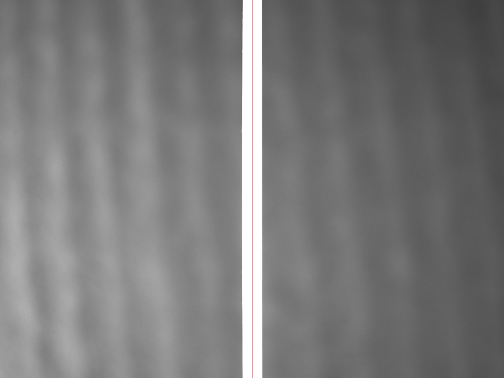
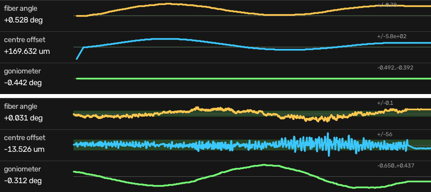
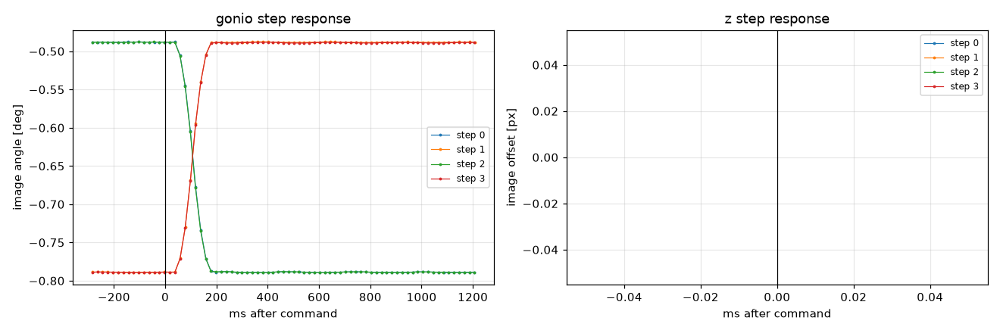
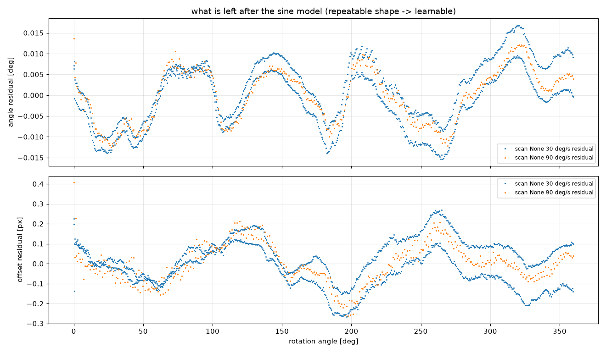
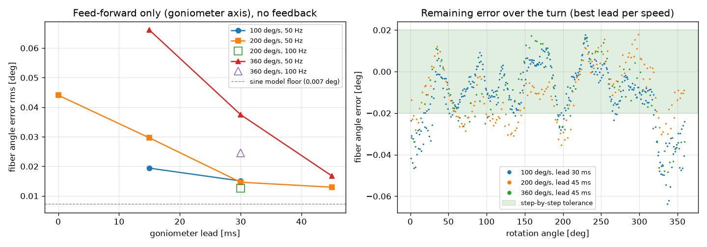

# Camera-guided alignment of a rotating fiber: from step-by-step feedback to predictive control (kayEi)

Working document, started 2026-10-31. Everything here is measured on the station in
`C:\dev\hydra`; scripts and raw data are named at each step so every number can be
regenerated. Numbers are given as measured, including the ones that did not work.

## 1. Problem

A fiber (diameter about 1.1 mm as seen by the camera) is held in a 3-jaw chuck on a
rotation stage. The side surface of the fiber has to stay in the focal plane of a
processing laser while the fiber rotates about its axis and is translated along it.
Two things move the surface out of the plane:

- the fiber axis is **tilted** with respect to the rotation axis (chuck, fiber bend),
  so its direction in the image changes with the rotation angle;
- the fiber axis is **offset** from the rotation axis (eccentricity), so its position
  in the image changes with the rotation angle, and because of the tilt this offset
  also changes along the fiber.

In the setup the laser focus is simulated by the camera's own position. Alignment means:
the fiber appears straight along a reference direction (goniometer) and centred
(camera height stage), at every rotation angle and every position along the fiber.

## 2. Setup

```
goniometer (Hydra axis 1, 2-phase stepper, +/-5.17 deg, 4 deg/s, accel 50 deg/s^2)
  -> rotation stage (Hydra axis 2, brushless servo, encoder, 360 deg/s, 10000 deg/s^2)
     -> 3-jaw chuck -> fiber
scan stage (PI C-663 SN 0165500183, VT-80 50 mm, along the fiber)
  -> Z stage (PI C-663 SN 0165500187, VT-80 25 mm, camera height)
     -> Baumer VCXG-15M GigE camera, 1440 x 1080, mono 8 bit, 20 ms exposure
```

| Quantity | Value | How it was obtained |
|---|---|---|
| Image scale | 49.5 px per mm of Z travel, i.e. **~20 um/px** | Z calibration, `fiber_align.py --calib` |
| Camera orientation | rotated 90 deg: the fiber appears vertical, Z moves it sideways | Z scan, `find_fiber.py` |
| Goniometer -> image angle | -1.01 to -1.02 deg/deg | calibration (4 repeats over 2 days) |
| Goniometer -> image offset | -62 to -74 px/deg at scan position 1 mm (lever arm from the pivot; changes along the scan) | calibration |
| Frame period | 20.2 ms (exposure bound) | `kayei_learn.py latency` |
| Hydra query / command | ~7 ms | timing test |
| PI C-663 (USB) query / MOV | ~32 ms / ~16 ms | timing test 2026-10-30 |

The PI controllers are slow to ask; all loops therefore work with *commanded* PI positions
and only poll when they must.

## 3. Measuring the fiber in the image

`fiber_align.measure()` fits both fiber edges. The image is cut into 36 horizontal bands;
in each band the column profile is thresholded and the **outermost** crossings on both
sides are taken, each at half of its *own* rim height, with sub-pixel interpolation.
The centre line of all bands is fitted with a straight line, giving

- the fiber **angle** in the image (deg from vertical),
- the **offset** of the centre line from the image centre (px) at mid-height,
- the width and the rms of the straight-line fit (a quality check; frames with a poor
  fit are not used for control).

Why outermost edges: the fiber is a transparent cylinder. At short exposure it shows two
bright rims, a dim core and glints. A simple threshold at the brightest point locks on a
glint and gives wrong angles. With the outermost-edge rule the measurement is consistent
from 10 ms to 50 ms exposure (angle within 0.05 deg, offset within 0.3 px); below 10 ms
the rims are too dim, at 100 ms the background saturates. Default: 20 ms, camera gain
raised automatically when the illumination is dim (`kayei_learn.Rig`).

Noise floor with everything static: **0.0002 deg** angle, 0.02 px offset (std over 15
frames). This is far below any mechanical effect.

## 4. Step-by-step alignment (2026-10-30)

`fiber_align.py`: calibrate (finite differences of goniometer and Z), then iterate
"goniometer removes the angle, Z removes the offset" until |angle| < 0.02 deg and
|offset| < 1 px. At six rotation angles (0..300 deg) every alignment converged in 1-2
iterations, about 1.5 s each:

| Rotation | Goniometer | Z (mm) | Remaining angle | Remaining offset |
|---|---|---|---|---|
| 0 | -0.309 | 13.557 | +0.006 deg | -0.35 px |
| 60 | -0.006 | 13.331 | +0.017 | -0.17 |
| 120 | +0.248 | 13.165 | +0.018 | -0.13 |
| 180 | +0.191 | 13.223 | +0.000 | +0.04 |
| 240 | -0.103 | 13.433 | -0.015 | +0.07 |
| 300 | -0.354 | 13.587 | -0.016 | +0.35 |

The goniometer setting over the turn already shows the sine that is the subject of
everything below. Data: `fiber_align.csv`, images `fiber_align_<angle>.png`.



## 5. Feedback tracking while rotating ("live align", 2026-10-30)

Rotation and scan run continuously; every fresh frame the goniometer gets a
proportional correction of the measured angle and Z of the measured offset (gain 0.6,
dead band 0.005 deg / 0.3 px, 36-44 corrections/s). `gui.py`, LIVE mode "Live align".

| Rotation speed | Angle error rms / max | Offset error rms / max |
|---|---|---|
| no compensation ("as is"), 20 deg/s | 0.27-0.41 deg / 0.55-0.68 | 150-182 um / 350-362 um |
| live align, 20 deg/s | 0.021 deg / 0.058 | 9.7 um / 57 um |
| live align, 50 deg/s | 0.039 / 0.081 | 9.1 / 34 |
| live align, 100 deg/s | **0.111** / 0.248 | 27.6 / 105 |



Top: without compensation the angle and offset follow slow sines while the goniometer
stays flat. Bottom: with feedback the errors stay inside the tolerance band and the
goniometer does the sine instead. Feedback is good at low speed and degrades with speed:
it only *reacts*, so with a loop delay tau the error grows like (wobble rate x tau).

## 6. System identification for prediction (2026-10-31)

### 6.1 Latency: command -> image

`kayei_learn.py latency`: 0.3 deg goniometer steps while grabbing fresh frames.

- The image responds **58 ms** after the command (4 repeats, all 58 ms).
- The step is settled after **159 ms** (goniometer travel at 4 deg/s with 50 deg/s^2).
- Angle noise during the test 0.0002 deg.



### 6.2 The wobble is a sine - and how good a sine

Geometry: a straight fiber is a line offset by (e_x, e_y) from the rotation axis at the
chuck and tilted by (t_x, t_y). Rotating by th and projecting onto the camera's view
plane gives

```
angle(th)      = a0 + A1 cos th + A2 sin th                   (independent of scan position s)
offset(th, s)  = b0 + b1 s + (B1 + C1 s) cos th + (B2 + C2 s) sin th
```

`kayei_learn.py wobble`: two full turns at 30 and at 90 deg/s with the goniometer fixed,
fresh frames stamped with the encoder angle.

| Speed | Angle: amplitude, fit residual, turn 1 -> turn 2 | Offset: amplitude, residual, turn 1 -> 2 |
|---|---|---|
| 30 deg/s | 0.440 deg, **0.0073 deg**, 0.0081 deg | 17.15 px (0.35 mm), **0.106 px**, 0.104 px |
| 90 deg/s | 0.441 deg, 0.0064 deg, 0.0064 deg | 17.13 px, 0.098 px, 0.096 px |

The residual after the sine is 1.7 % of the amplitude for the angle and 0.6 % for the
offset, and a model fitted on turn 1 predicts turn 2 equally well. The residual has a
repeatable shape over the turn (the two turns and the two speeds overlap in the figure):
higher harmonics of about +/-0.015 deg and +/-0.25 px, presumably bearing / chuck
signature. Repeatable means learnable (section 7.3).



### 6.3 Frame-to-encoder delay

The phase of the fitted sine shifts by +1.6 deg (angle) / +1.9 deg (offset) between 30
and 90 deg/s, i.e. the frame is exposed about **30 ms** before the encoder is read after
it arrives. With this correction applied, the measured phase is the same at 90, 200 and
360 deg/s within 0.4 deg. (`FRAME_DELAY = 0.030 s` in `kayei.py`.)

### 6.4 Goniometer dynamics

Three tests separate controller, mechanics and loop:

| Test | Result |
|---|---|
| Hydra executing a 50 Hz stream of `nm` commands along a 0.44 deg sine, read back with `np` (rotation stopped) | full amplitude at all periods; lag 25 / 30 / 35 ms for peak rates 0.38 / 0.77 / 1.54 deg/s; 0.002-0.007 deg deviation |
| same, read back by the **camera** (fiber angle) | full amplitude; lag 66 / 66 / 74 / 84 ms (arrival-time basis) for 0.38 / 0.77 / 1.54 / 3.07 deg/s; 0.004-0.025 deg |
| Hydra readback of the stream while the rotation spins at 200 deg/s | still full amplitude, lag 46 ms (vs 34 ms without spin) |

The goniometer therefore follows a 50 Hz target stream well up to rates beyond what a
360 deg/s rotation requires (0.44 deg x 2 pi x 1 turn/s = 2.8 deg/s), with a delay that
grows slowly with the rate.

### 6.5 Z stage dynamics

Same tests as 6.4 for the camera height stage (PI C-663, VT-80 25 mm), camera-timed
(`kayei_data/z_dyn.py`): a 0.2 mm step shows in the image after **58 ms** (4 repeats) and
is settled after 98 ms; a 0.45 mm sine stream at 50 Hz is followed with full amplitude and
60 / 64 / 68 ms lag for peak rates 0.79 / 1.57 / 2.83 mm/s (8-16 um rms), identical at
stage velocity 10 and 20 mm/s. Z therefore gets the same lead law as the goniometer.
The first full-system run used a guessed 60 ms Z lead and showed 22 um rms offset error;
the measured ~35 ms lead brought it to 10 um (7.2b) - a 25 ms lead error at 100 deg/s is
2.5 deg of phase on a 22 px sine, i.e. about 1 px.

### 6.6 Controller quirks found on the way (Hydra TT, Venus-3)

- `setnpos v` sets the *origin*: the current position becomes **-v**. It also drags the
  soft limits to [pos - 72000, pos].
- A move whose target lies outside the soft limits is refused with error **1004**
  (not executed at all). This is what stopped a sweep after ~17000 deg of one-way
  rotation, and is the likely meaning of the 1004 errors seen the day before.
- Fix: `Hydra.rezero_turn()` keeps the rotation count within one turn (same angle modulo
  360, so learned models stay valid) and sets the limits to +/-36000 deg explicitly.

## 7. kayEi: predictive alignment

### 7.1 Idea

The disturbance is a known function of the rotation angle, and the rotation angle is
known in advance (encoder repeatable to 0.00003 deg, commanded speed accurate to 0.01 %).
So the goniometer and Z are driven to where the fiber *will* be; the camera no longer
has to chase. Components (`kayei.py`):

- **RotClock**: rotation angle as a function of time from the commanded speed, re-synced
  to the encoder every 0.25 s (clock vs encoder < 1 deg at 360 deg/s).
- **WobbleModel**: the sine of section 6.2, linear in the scan position (6 coefficients
  for the offset, 3 for the angle), fitted from two learning turns.
- **Predictor**: goniometer = g_al - angle(th)/a_per_g; Z = z_al - (offset(th, s) +
  x_per_g(s) * dg)/x_per_z, where x_per_g(s) is the goniometer's image shift at scan
  position s (lever arm, linear in s). g_al, z_al: the aligned reference.
- **Tracker** thread: streams the targets at a fixed 50 or 100 Hz from the clock, with
  separate lead times for goniometer and Z, over its own Hydra socket. The camera loop
  is decoupled: it measures, learns and re-syncs the clock.
- **Residual** table (iterative learning): 72 bins over the turn; whatever the camera
  still sees at an angle is written into the bin (gain 0.3) and applied on the next
  visits. The table is kept zero-mean; the mean goes to a slow integral **trim**.

### 7.2 Results so far: goniometer axis, feed-forward only

No residual table, no trim, learned from two turns at 90 deg/s (`kayei_data/gonio_tracker.csv`,
`kayei_data/tracker_test.py`):

| Rotation | Lead 0 | 15 ms | 30 ms | 45 ms | 30 ms @ 100 Hz |
|---|---|---|---|---|---|
| 100 deg/s | - | 0.019 | **0.015** | - | - |
| 200 deg/s | 0.044 | 0.030 | 0.015 | **0.013** | 0.0125 |
| 360 deg/s | - | 0.066 | 0.038 | **0.017** | 0.025 |

(angle error rms over turns 2-3, deg; every run has a constant bias of -0.011 deg that
the trim will remove, so the shape error alone is about 0.010 deg at 100-200 deg/s.)



Compared with feedback at 100 deg/s (0.111 deg) this is 7-8x better, and 360 deg/s -
not reachable with feedback at all - is within the step-by-step tolerance. The best lead
grows with speed (30 -> 45 ms), consistent with the rate-dependent goniometer lag of
6.4; the lead will be a function of the required rate rather than a constant.

An earlier version of this test (camera loop and goniometer commands in one thread,
`kayei_data/gonio_ff_test.csv`) gave 0.099 deg at 200 deg/s with a clean, repeatable
error sine that could not be reproduced afterwards (same configuration: 0.033 deg). It
is recorded here because it is unexplained, not because it is understood.

### 7.2b Full system at 100 deg/s (goniometer + Z + scan), 2026-10-31 afternoon

Through the GUI worker (`gui.py` LIVE mode "kayEi", residual learning on), rotation
100 deg/s, scan 5-45 mm at 1 mm/s where noted. Errors after the first turn
(`kayei_eval.py`):

| Change | Scan | Angle rms / max | Offset rms / max |
|---|---|---|---|
| first full run (Z lead guessed 60 ms, angle model without s) | no | 0.0098 deg / 0.039 | 21.7 um / 88 |
| same | yes | 0.0377 / 0.177 | 57.1 / 312 |
| Z lead measured (35 ms), angle model linear in s | no | 0.0083 / 0.040 | 9.9 / 47 |
| same | yes | 0.0139 / 0.105 | 22.4 / 190 |
| + pre-positioning before the rotation starts, residual learning only after turn 1, query-free scan turnaround | yes | **0.0078 / 0.032** | **7.4 / 42** |

Two things were learned on the way, both visible only in the per-frame logs:

- **The fiber is not straight over 45 mm.** With learning turns at both ends of the scan,
  the angle sine differs between the ends (amplitude change 0.005 deg/mm); a model with
  the angle independent of s had a 0.08 deg residual, with the angle linear in s it is
  back to 0.006 deg. The goniometer lever arm also changes along the scan, as expected:
  x_per_g = -84 + 0.82 s px/deg (0.86 predicted from tan(1 deg) x 49.5 px/mm).
- **Start transients get learned.** The residual table wrote the start jump of the first
  turn into the bins of the start angle (0.03-0.04 deg, 50-70 um at th = 120-160 deg,
  decaying by 30 % per turn). Letting the axes settle before the rotation starts and
  enabling the table only after one full turn removed it.

### 7.3 Next steps

1. ~~Z and scan axes in the same scheme~~ done (7.2b).
2. ~~Residual table and trim~~ on; the table now holds +/-0.02 deg / +/-40 um of shape.
3. Full-system evaluation: as is / live align / kayEi at 20, 50, 100, 200, 360 deg/s,
   with and without scanning (`kayei_sweep.py`, `kayei_eval.py`) - running, see 7.4.
4. ~~Learn at two scan positions~~ done, including the lever-arm calibration at both.
5. Open physics: the out-of-plane components (e_y, t_y) are the focus variation. No axis
   corrects them in this setup; they can at least be predicted from the same model.

## 8. Experiment log

| Date | Experiment | Script / data | Key numbers |
|---|---|---|---|
| 2026-10-20 | Hydra dynamics, rotation step/settle | `dynamics.py`, `spin_steps.py` | 360 deg/s reached within 0.01 %; settle 50-74 ms; hold +/-0.02 mdeg |
| 2026-10-30 | 4 axes simultaneously | `all_axes.py` | all on target after 40 s of mixed speeds |
| 2026-10-30 | fiber found by Z scan, centred | `find_fiber.py` | -49.8 px/mm Z |
| 2026-10-30 | alignment at 6 rotation angles | `fiber_align.py` | 0.02 deg / 1 px in 1-2 iterations |
| 2026-10-30 | as is vs live align | `gui.py`, `gui_log.txt` | 0.27-0.41 -> 0.021 deg; 150-182 -> 9.7 um |
| 2026-10-30 | live align vs speed | `gui_log.txt` | 0.021 / 0.039 / 0.111 deg at 20 / 50 / 100 deg/s |
| 2026-10-31 | latency step test | `kayei_learn.py latency`, `kayei_data/latency.csv` | 58 ms response, 159 ms settle |
| 2026-10-31 | wobble sine model | `kayei_learn.py wobble`, `kayei_data/wobble.csv` | residual 0.007 deg / 0.1 px, repeatable |
| 2026-10-31 | goniometer stream tests | `kayei_data/mech_test.py` | 25-84 ms lag, full amplitude |
| 2026-10-31 | Z dynamics (step, sine stream) | `kayei_data/z_dyn.py` | 58 ms response, 60-68 ms sine lag |
| 2026-10-31 | kayEi full system at 100 deg/s | `kayei_data/run_20261031_17*.csv` | 0.0078 deg / 7.4 um with scan |
| 2026-10-31 | kayEi goniometer lead sweep | `kayei_data/tracker_test.py`, `kayei_data/gonio_tracker.csv` | 0.013-0.017 deg at 200-360 deg/s |

## 9. Reproducing

```
C:\dev\hydra\.venv\Scripts\python kayei_learn.py latency     # 6.1
C:\dev\hydra\.venv\Scripts\python kayei_learn.py wobble      # 6.2, 6.3
C:\dev\hydra\.venv\Scripts\python gui.py                     # sections 4, 5, 7 (LIVE modes)
```

Raw data in `kayei_data/`, figures in `docs/figures/`. Hardware must be homed first
(GUI: Home all Hydra, Ref. PI stages).
